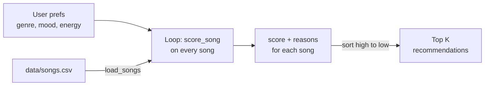

# 🎵 Music Recommender Simulation

## Project Summary

In this project you will build and explain a small music recommender system.

Your goal is to:

- Represent songs and a user "taste profile" as data
- Design a scoring rule that turns that data into recommendations
- Evaluate what your system gets right and wrong
- Reflect on how this mirrors real world AI recommenders

**VibeFinder 1.0** is a content-based recommender that runs in the terminal. It reads an 18-song catalog from `data/songs.csv`, scores every song against a user's taste profile (favorite genre, favorite mood, target energy, and optionally whether they like acoustic sound), and prints the top 5 songs along with the reasons each one scored the way it did.

---

## How The System Works

### How real platforms do it

Spotify, YouTube, and TikTok mix two main approaches:

- **Collaborative filtering** uses other people's behavior. If listeners who like the same songs as you also play a song you've never heard, it gets recommended to you. It needs no knowledge of the music itself, only plays, likes, skips, saves, playlist adds, shares, and how long people watch or listen. Its weakness is the "cold start" problem: a brand-new song or user has no history to work with.
- **Content-based filtering** uses the item's attributes. A song is described by features like genre, tempo, energy, valence (how positive it sounds), danceability, and acousticness, and the system recommends songs whose features are close to what you already like. It works for new songs, but it tends to keep recommending more of the same.

Real systems combine both, along with context like time of day and device, and they learn their weights from billions of interactions. They also have to deal with noisy signals: a skip in the first 5 seconds means something very different from a skip at the end of a song.

**My version is purely content-based.** There are no other users to learn from, so it relies on song attributes and a hand-written scoring rule. It prioritizes **genre first, then mood, then how close the energy is** to what the user wants.

### Choosing features (from `data/songs.csv`)

The catalog has `genre`, `mood`, `energy`, `tempo_bpm`, `valence`, `danceability`, and `acousticness`. For a simple recommender, I'm using:

- **genre** and **mood**: the clearest signals of "vibe" and the way people actually describe what they want ("chill lofi," "happy pop").
- **energy**: the best single number for the feel of a track. It separates a workout song from a study song even when the genre is the same (Gym Hero vs. Sunrise City are both pop).
- **acousticness**: an optional tiebreaker for users who prefer acoustic or electronic sound.

I left out **tempo_bpm**, because it overlaps heavily with energy and is on a different scale (60–168), so it would need normalizing. **Valence** and **danceability** also mostly follow energy and mood in this small dataset. That matches my own experience: when I describe a vibe I think "chill" or "hype" first, which is mood plus energy, not a BPM number.

### Objects

- `Song`: `id`, `title`, `artist`, `genre`, `mood`, `energy`, `tempo_bpm`, `valence`, `danceability`, `acousticness`, plus the advanced features `popularity`, `release_decade`, `mood_tags`, `instrumentalness`, `liveness` (see [Optional Extensions](#optional-extensions))
- `UserProfile`: `favorite_genre`, `favorite_mood`, `target_energy`, `likes_acoustic`

The functional API in `main.py` uses the same profile as a dictionary:

```python
user_prefs = {"genre": "pop", "mood": "happy", "energy": 0.8}            # likes_acoustic is optional
```

A profile with all three values can tell "intense rock" (`rock`, `intense`, `0.9`) apart from "chill lofi" (`lofi`, `chill`, `0.35`), because all three signals disagree. A profile with only a genre would be too narrow: every lofi song would tie.

### Algorithm Recipe

**Scoring Rule** (judges one song):

| Signal | Points |
|---|---|
| Genre matches the user's favorite genre | **+2.0** |
| Mood matches the user's favorite mood | **+1.0** |
| Energy closeness: `1.0 × (1 − |song.energy − target_energy|)` | **0.0 to +1.0** |
| Acoustic preference (only if `likes_acoustic` is set): `0.5 × acousticness` if they like acoustic, otherwise `0.5 × (1 − acousticness)` | **0.0 to +0.5** |

The energy rule rewards being *close* to the target instead of being high or low: a 0.80 song gets 1.0 points for a 0.80 target, while a 0.30 song gets only 0.5. Genre is worth the most because it's usually the strongest preference (a jazz fan rarely wants metal, even if the mood matches). Mood is worth half as much because people are more flexible about it.

**Ranking Rule** (orders the list): score every song in the catalog, sort from highest to lowest score, and return the top `k`. The Scoring Rule alone only says how good *one* song is. The Ranking Rule turns those numbers into a decision about *which* songs to show and in what order.

### Data flow



### Biases I expect

- **Genre dominance:** a genre match (+2.0) is worth more than a perfect mood and energy match combined (+2.0), so a great song in the "wrong" genre can lose to a mediocre song in the right one.
- **Exact string matching:** "indie pop" does not count as "pop," so close genres get no partial credit.
- **Small, uneven catalog:** most genres have only 1 song, so a lofi fan has 3 options but a metal fan has 1. After that one song, results are just "whatever has similar energy."

---

## Getting Started

### Setup

1. Create a virtual environment (optional but recommended):

   ```bash
   python -m venv .venv
   source .venv/bin/activate      # Mac or Linux
   .venv\Scripts\activate         # Windows
   ```

2. Install dependencies

```bash
pip install -r requirements.txt
```

3. Run the app:

```bash
python -m src.main                     # balanced mode, the seven test profiles
python -m src.main --experiment        # Phase 4 weight shift (same as --mode energy-focused)
python -m src.main --mode mood-first   # balanced | genre-first | mood-first | energy-focused
python -m src.main --diverse           # penalize repeated artists and genres
python -m src.main --table             # ASCII table output
python -m src.main --advanced          # profiles that use the advanced song features
```

Flags can be combined, for example `python -m src.main --advanced --diverse --table`.

### Running Tests

Run the tests (10 checks covering loading, scoring, ranking, modes, and diversity) with:

```bash
pytest
```

You can add more tests in `tests/test_recommender.py`.

---

## Sample Recommendation Output

Output of `python -m src.main` for the default pop/happy profile (the full run also prints the other six profiles):

```
Loaded songs: 18

Mode: balanced (genre first, then mood, then energy)
Diversity penalty: off

============================================================
Profile: Default Pop/Happy
Prefs:   genre=pop, mood=happy, energy=0.8
------------------------------------------------------------
1. Sunrise City by Neon Echo (pop, happy)
   Score: 3.98
   - genre match (+2.0)
   - mood match (+1.0)
   - energy 0.82 vs target 0.80 (+0.98)
2. Gym Hero by Max Pulse (pop, intense)
   Score: 2.87
   - genre match (+2.0)
   - energy 0.93 vs target 0.80 (+0.87)
3. Rooftop Lights by Indigo Parade (indie pop, happy)
   Score: 1.96
   - mood match (+1.0)
   - energy 0.76 vs target 0.80 (+0.96)
4. Block Party Anthem by MC Lumen (hip hop, energetic)
   Score: 0.96
   - energy 0.84 vs target 0.80 (+0.96)
5. Night Drive Loop by Neon Echo (synthwave, moody)
   Score: 0.95
   - energy 0.75 vs target 0.80 (+0.95)
```

The top result matches what I'd expect: Sunrise City is the only song that matches pop, happy, and the target energy. Gym Hero ranks second on genre and energy alone, even though it's an intense workout track, not a happy one.

---

## Optional Extensions

### Challenge 1: Advanced song features

`data/songs.csv` has five new columns, and `score_song` scores each one only when the user sets the matching preference. That way, the seven basic profiles score exactly as before.

| Column | Values | User preference | Points |
|---|---|---|---|
| `popularity` | 0–100 | `popularity`: target 0–100 | up to +0.5, closer is better (same rule as energy) |
| `release_decade` | 1950–2020 | `decade`: e.g. `1980` | +0.5 same decade, +0.25 one decade off |
| `mood_tags` | 3 detailed tags, e.g. `nostalgic\|nocturnal\|driving` | `mood_tags`: list of tags | +0.25 per shared tag (max 3) |
| `instrumentalness` | 0–1 | `instrumental`: True/False | up to +0.5 |
| `liveness` | 0–1 | `likes_live`: True/False | up to +0.25 |

`python -m src.main --advanced`:

```
============================================================
Profile: Late-Night Study
Prefs:   genre=lofi, mood=focused, energy=0.4, mood_tags=['calm', 'nocturnal'], instrumental=True, likes_live=False
------------------------------------------------------------
1. Focus Flow by LoRoom (lofi, focused)
   Score: 4.93
   - genre match (+2.0)
   - mood match (+1.0)
   - energy 0.40 vs target 0.40 (+1.00)
   - mood tags calm (+0.25)
   - instrumental preference (+0.45)
   - studio sound preference (+0.23)
2. Midnight Coding by LoRoom (lofi, chill)
   Score: 4.15
   - genre match (+2.0)
   - energy 0.42 vs target 0.40 (+0.98)
   - mood tags calm, nocturnal (+0.50)
   - instrumental preference (+0.44)
   - studio sound preference (+0.23)
3. Library Rain by Paper Lanterns (lofi, chill)
   Score: 3.90
   - genre match (+2.0)
   - energy 0.35 vs target 0.40 (+0.95)
   - mood tags calm (+0.25)
   - instrumental preference (+0.46)
   - studio sound preference (+0.23)
4. Spacewalk Thoughts by Orbit Bloom (ambient, chill)
   Score: 1.84
   - energy 0.28 vs target 0.40 (+0.88)
   - mood tags calm (+0.25)
   - instrumental preference (+0.47)
   - studio sound preference (+0.24)
5. Rainy Window Sonata by Elm Street Quartet (classical, melancholy)
   Score: 1.52
   - energy 0.20 vs target 0.40 (+0.80)
   - instrumental preference (+0.49)
   - studio sound preference (+0.23)

============================================================
Profile: Throwback Road Trip
Prefs:   mood=nostalgic, energy=0.6, decade=1980, mood_tags=['nostalgic', 'driving', 'warm'], popularity=60
------------------------------------------------------------
1. Porch Light Letters by Willow Creek (country, nostalgic)
   Score: 2.90
   - mood match (+1.0)
   - energy 0.52 vs target 0.60 (+0.92)
   - mood tags nostalgic, warm (+0.50)
   - popularity 63 vs target 60 (+0.48)
2. Night Drive Loop by Neon Echo (synthwave, moody)
   Score: 2.35
   - energy 0.75 vs target 0.60 (+0.85)
   - 1980s release (+0.50)
   - mood tags nostalgic, driving (+0.50)
   - popularity 61 vs target 60 (+0.49)
3. Island Time by Coral Sound System (reggae, relaxed)
   Score: 1.88
   - energy 0.50 vs target 0.60 (+0.90)
   - 1970s release (+0.25)
   - mood tags warm (+0.25)
   - popularity 57 vs target 60 (+0.48)
4. Velvet Hours by Amber Vale (r&b, romantic)
   Score: 1.87
   - energy 0.55 vs target 0.60 (+0.95)
   - 1990s release (+0.25)
   - mood tags warm (+0.25)
   - popularity 76 vs target 60 (+0.42)
5. Coffee Shop Stories by Slow Stereo (jazz, relaxed)
   Score: 1.68
   - energy 0.37 vs target 0.60 (+0.77)
   - mood tags warm, nostalgic (+0.50)
   - popularity 41 vs target 60 (+0.41)

============================================================
Profile: Underground Headbanger
Prefs:   genre=metal, mood=angry, energy=0.95, mood_tags=['aggressive', 'rebellious'], popularity=30, instrumental=False, likes_live=True
------------------------------------------------------------
1. Iron Verdict by Black Anvil (metal, angry)
   Score: 5.43
   - genre match (+2.0)
   - mood match (+1.0)
   - energy 0.97 vs target 0.95 (+0.98)
   - mood tags aggressive, rebellious (+0.50)
   - popularity 45 vs target 30 (+0.42)
   - vocals preference (+0.42)
   - live sound preference (+0.10)
2. Storm Runner by Voltline (rock, intense)
   Score: 2.29
   - energy 0.91 vs target 0.95 (+0.96)
   - mood tags aggressive, rebellious (+0.50)
   - popularity 67 vs target 30 (+0.32)
   - vocals preference (+0.45)
   - live sound preference (+0.06)
3. Gym Hero by Max Pulse (pop, intense)
   Score: 1.98
   - energy 0.93 vs target 0.95 (+0.98)
   - mood tags aggressive (+0.25)
   - popularity 88 vs target 30 (+0.21)
   - vocals preference (+0.49)
   - live sound preference (+0.04)
4. Block Party Anthem by MC Lumen (hip hop, energetic)
   Score: 1.78
   - energy 0.84 vs target 0.95 (+0.89)
   - popularity 79 vs target 30 (+0.26)
   - vocals preference (+0.50)
   - live sound preference (+0.14)
5. Rooftop Lights by Indigo Parade (indie pop, happy)
   Score: 1.66
   - energy 0.76 vs target 0.95 (+0.81)
   - popularity 70 vs target 30 (+0.30)
   - vocals preference (+0.47)
   - live sound preference (+0.07)
```

The tags and decade did real work. For Throwback Road Trip, Night Drive Loop (synthwave, *moody*) still placed second with no mood match, because it's the only 1980s song and shares two tags. Detailed tags give partial credit where the single `mood` label is all-or-nothing.

### Challenge 2: Multiple scoring modes

Each mode is a `ScoringMode` object (Strategy pattern) with its own weights, and `recommend_songs` calls `mode.score(...)` without knowing which mode it has. Pick a mode with `--mode`.

| Mode | Genre | Mood | Energy | Default Pop/Happy, #2–#3 | Chill Lofi, #3–#4 |
|---|---|---|---|---|---|
| `balanced` | 2.0 | 1.0 | 1.0 | Gym Hero, Rooftop Lights | Focus Flow, Spacewalk Thoughts |
| `genre-first` | 3.0 | 0.5 | 0.5 | Gym Hero, Rooftop Lights (gap grows: 3.44 vs 0.98) | Focus Flow, Spacewalk Thoughts |
| `mood-first` | 0.5 | 2.0 | 1.0 | **Rooftop Lights, Gym Hero** | **Spacewalk Thoughts, Focus Flow** |
| `energy-focused` | 1.0 | 1.0 | 2.0 | **Rooftop Lights, Gym Hero** | **Spacewalk Thoughts, Focus Flow** |

The #1 song never changes for these profiles, because it matches everything. The modes only reorder the "partial matches," which is where the weights express a real opinion about what matters more.

### Challenge 3: Diversity penalty

`--diverse` builds the top 5 one pick at a time. Each candidate loses **1.0 per song by the same artist** and **0.5 per song in the same genre** already picked, and the penalty shows up in the reasons.

| Profile | Without `--diverse` | With `--diverse` |
|---|---|---|
| Default Pop/Happy | …, Block Party Anthem, Night Drive Loop | …, Block Party Anthem, **Storm Runner** (Night Drive Loop is a second Neon Echo song) |
| Chill Lofi | Library Rain, Midnight Coding, Focus Flow, Spacewalk Thoughts, Coffee Shop Stories | Library Rain, Midnight Coding, Spacewalk Thoughts, Coffee Shop Stories, **Empty Highway** (Focus Flow is a second LoRoom song and a third lofi song) |
| Mood Only (no genre) | Midnight Coding, Library Rain, Spacewalk Thoughts, … | Midnight Coding, **Spacewalk Thoughts**, Library Rain, … |
| Conflicted (sad but high energy) | unchanged | unchanged |

**Trade-off:** variety isn't free. For Chill Lofi, the penalty swaps a focused lofi track for a *sad folk* song, which is less relevant. It also doesn't fix the high-energy filter bubble, because those loud songs are all different artists and genres. Diversity by artist and genre is not the same as diversity by feel.

### Challenge 4: Table output

`python -m src.main --table --diverse` (first profile):

```
============================================================
Profile: Default Pop/Happy
Prefs:   genre=pop, mood=happy, energy=0.8
------------------------------------------------------------
+---+--------------------+---------------+---------------------+-------+--------------------------------------------+
| # | Title              | Artist        | Genre / Mood        | Score | Reasons                                    |
+===+====================+===============+=====================+=======+============================================+
| 1 | Sunrise City       | Neon Echo     | pop / happy         | 3.98  | genre match (+2.0)                         |
|   |                    |               |                     |       | mood match (+1.0)                          |
|   |                    |               |                     |       | energy 0.82 vs target 0.80 (+0.98)         |
+---+--------------------+---------------+---------------------+-------+--------------------------------------------+
| 2 | Gym Hero           | Max Pulse     | pop / intense       | 2.37  | genre match (+2.0)                         |
|   |                    |               |                     |       | energy 0.93 vs target 0.80 (+0.87)         |
|   |                    |               |                     |       | diversity penalty: genre x1 already picked |
|   |                    |               |                     |       |   (-0.50)                                  |
+---+--------------------+---------------+---------------------+-------+--------------------------------------------+
| 3 | Rooftop Lights     | Indigo Parade | indie pop / happy   | 1.96  | mood match (+1.0)                          |
|   |                    |               |                     |       | energy 0.76 vs target 0.80 (+0.96)         |
+---+--------------------+---------------+---------------------+-------+--------------------------------------------+
| 4 | Block Party Anthem | MC Lumen      | hip hop / energetic | 0.96  | energy 0.84 vs target 0.80 (+0.96)         |
+---+--------------------+---------------+---------------------+-------+--------------------------------------------+
| 5 | Storm Runner       | Voltline      | rock / intense      | 0.89  | energy 0.91 vs target 0.80 (+0.89)         |
+---+--------------------+---------------+---------------------+-------+--------------------------------------------+
```

---

## Experiments You Tried

- **Seven user profiles** (`python -m src.main`): four normal tastes (Default Pop/Happy, High-Energy Pop, Chill Lofi, Deep Intense Rock) and three edge cases (sad but high energy, a genre missing from the catalog, and mood only with no genre). Full output and comparisons are in the [model card](model_card.md#7-evaluation).
- **Weight Shift** (`python -m src.main --experiment`): halved genre (2.0 → 1.0) and doubled energy (1.0 → 2.0). For pop/happy, Rooftop Lights (happy, right energy) moved above Gym Hero (intense), and for Chill Lofi the ambient chill track passed a "focused" lofi one. Both changes felt more accurate. The Deep Intense Rock list didn't change, and the sad but high-energy user still got a low-energy folk song first, just by a smaller margin.
- **Edge cases:** a "sad but energy 0.9" user got a quiet sad folk song (energy 0.30) at #1, because two label matches (+3.0) beat a big energy miss. A k-pop fan got zero genre points from anything, and results fell back to mood and energy.

---

## Limitations and Risks

- **Tiny, uneven catalog:** 18 songs, and most genres have just one, so a metal or folk fan gets one real match and four filler songs.
- **High-energy filter bubble:** 8 of 18 songs have energy 0.75 or higher, so the same loud tracks (Gym Hero, Block Party Anthem) fill the leftover spots in most lists.
- **Genre dominates:** a genre match is worth as much as perfect mood and energy combined.
- **Exact string matching:** "indie pop" isn't "pop," and "relaxed" isn't "chill."
- **No understanding of lyrics, language, or real listening behavior:** it only knows the labels in the CSV.

More detail is in the [model card](model_card.md#6-limitations-and-bias).

---

## Reflection

Read the full model card: [**Model Card**](model_card.md)

Building this showed me that a recommendation is just a score plus a sort. Each song is turned into a number by comparing its features to what the user asked for, and the "prediction" is whatever ends up on top. Real platforms do the same thing at a much bigger scale, with learned weights and other people's behavior (collaborative filtering) instead of my hand-picked +2 / +1 / energy recipe. Even four simple rules produced lists that felt like real playlists, and the "because" reasons made them seem smarter than they are.

Bias showed up in places I didn't expect. The weights themselves encode a judgment (genre matters twice as much as mood), and the catalog's shape quietly decides who gets good results. Lofi and pop fans had several real matches, while a metal or folk fan got one match and then whatever was loud. Nothing in the code says "prefer high-energy music," but that's what happens when the data is skewed and every song earns energy points. In a real app, the same effect could mean niche genres and smaller artists are rarely recommended, which then means fewer plays, which makes them look even less popular.
