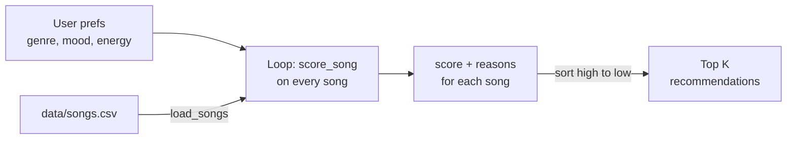

# 🎵 Music Recommender Simulation

## Project Summary

In this project you will build and explain a small music recommender system.

Your goal is to:

- Represent songs and a user "taste profile" as data
- Design a scoring rule that turns that data into recommendations
- Evaluate what your system gets right and wrong
- Reflect on how this mirrors real world AI recommenders

**VibeFinder 1.0** is a content-based recommender that runs in the terminal. It reads an 18-song catalog from `data/songs.csv`, scores every song against a user's taste profile (favorite genre, favorite mood, target energy, and optionally whether they like acoustic sound), and prints the top 5 songs along with the reasons each one scored the way it did.

---

## How The System Works

### How real platforms do it

Spotify, YouTube, and TikTok mix two main approaches:

- **Collaborative filtering** uses other people's behavior. If listeners who like the same songs as you also play a song you've never heard, it gets recommended to you. It needs no knowledge of the music itself, only plays, likes, skips, saves, playlist adds, shares, and how long people watch or listen. Its weakness is the "cold start" problem: a brand-new song or user has no history to work with.
- **Content-based filtering** uses the item's attributes. A song is described by features like genre, tempo, energy, valence (how positive it sounds), danceability, and acousticness, and the system recommends songs whose features are close to what you already like. It works for new songs, but it tends to keep recommending more of the same.

Real systems combine both, along with context like time of day and device, and they learn their weights from billions of interactions. They also have to deal with noisy signals: a skip in the first 5 seconds means something very different from a skip at the end of a song.

**My version is purely content-based.** There are no other users to learn from, so it relies on song attributes and a hand-written scoring rule. It prioritizes **genre first, then mood, then how close the energy is** to what the user wants.

### Choosing features (from `data/songs.csv`)

The catalog has `genre`, `mood`, `energy`, `tempo_bpm`, `valence`, `danceability`, and `acousticness`. For a simple recommender, I'm using:

- **genre** and **mood**: the clearest signals of "vibe" and the way people actually describe what they want ("chill lofi," "happy pop").
- **energy**: the best single number for the feel of a track. It separates a workout song from a study song even when the genre is the same (Gym Hero vs. Sunrise City are both pop).
- **acousticness**: an optional tiebreaker for users who prefer acoustic or electronic sound.

I left out **tempo_bpm**, because it overlaps heavily with energy and is on a different scale (60–168), so it would need normalizing. **Valence** and **danceability** also mostly follow energy and mood in this small dataset. That matches my own experience: when I describe a vibe I think "chill" or "hype" first, which is mood plus energy, not a BPM number.

### Objects

- `Song`: `id`, `title`, `artist`, `genre`, `mood`, `energy`, `tempo_bpm`, `valence`, `danceability`, `acousticness`
- `UserProfile`: `favorite_genre`, `favorite_mood`, `target_energy`, `likes_acoustic`

The functional API in `main.py` uses the same profile as a dictionary:

```python
user_prefs = {"genre": "pop", "mood": "happy", "energy": 0.8}            # likes_acoustic is optional
```

A profile with all three values can tell "intense rock" (`rock`, `intense`, `0.9`) apart from "chill lofi" (`lofi`, `chill`, `0.35`), because all three signals disagree. A profile with only a genre would be too narrow: every lofi song would tie.

### Algorithm Recipe

**Scoring Rule** (judges one song):

| Signal | Points |
|---|---|
| Genre matches the user's favorite genre | **+2.0** |
| Mood matches the user's favorite mood | **+1.0** |
| Energy closeness: `1.0 × (1 − |song.energy − target_energy|)` | **0.0 to +1.0** |
| Acoustic preference (only if `likes_acoustic` is set): `0.5 × acousticness` if they like acoustic, otherwise `0.5 × (1 − acousticness)` | **0.0 to +0.5** |

The energy rule rewards being *close* to the target instead of being high or low: a 0.80 song gets 1.0 points for a 0.80 target, while a 0.30 song gets only 0.5. Genre is worth the most because it's usually the strongest preference (a jazz fan rarely wants metal, even if the mood matches). Mood is worth half as much because people are more flexible about it.

**Ranking Rule** (orders the list): score every song in the catalog, sort from highest to lowest score, and return the top `k`. The Scoring Rule alone only says how good *one* song is. The Ranking Rule turns those numbers into a decision about *which* songs to show and in what order.

### Data flow



### Biases I expect

- **Genre dominance:** a genre match (+2.0) is worth more than a perfect mood and energy match combined (+2.0), so a great song in the "wrong" genre can lose to a mediocre song in the right one.
- **Exact string matching:** "indie pop" does not count as "pop," so close genres get no partial credit.
- **Small, uneven catalog:** most genres have only 1 song, so a lofi fan has 3 options but a metal fan has 1. After that one song, results are just "whatever has similar energy."

---

## Getting Started

### Setup

1. Create a virtual environment (optional but recommended):

   ```bash
   python -m venv .venv
   source .venv/bin/activate      # Mac or Linux
   .venv\Scripts\activate         # Windows
   ```

2. Install dependencies

```bash
pip install -r requirements.txt
```

3. Run the app:

```bash
python -m src.main
```

### Running Tests

Run the starter tests with:

```bash
pytest
```

You can add more tests in `tests/test_recommender.py`.

---

## Sample Recommendation Output

Output of `python -m src.main` for the default pop/happy profile (the full run also prints the other six profiles):

```
Loaded songs: 18

Weights: {'genre': 2.0, 'mood': 1.0, 'energy': 1.0, 'acoustic': 0.5}

============================================================
Profile: Default Pop/Happy
Prefs:   genre=pop, mood=happy, energy=0.8
------------------------------------------------------------
1. Sunrise City by Neon Echo (pop, happy)
   Score: 3.98
   - genre match (+2.0)
   - mood match (+1.0)
   - energy 0.82 vs target 0.80 (+0.98)
2. Gym Hero by Max Pulse (pop, intense)
   Score: 2.87
   - genre match (+2.0)
   - energy 0.93 vs target 0.80 (+0.87)
3. Rooftop Lights by Indigo Parade (indie pop, happy)
   Score: 1.96
   - mood match (+1.0)
   - energy 0.76 vs target 0.80 (+0.96)
4. Block Party Anthem by MC Lumen (hip hop, energetic)
   Score: 0.96
   - energy 0.84 vs target 0.80 (+0.96)
5. Night Drive Loop by Neon Echo (synthwave, moody)
   Score: 0.95
   - energy 0.75 vs target 0.80 (+0.95)
```

The top result matches what I'd expect: Sunrise City is the only song that matches pop, happy, and the target energy. Gym Hero ranks second on genre and energy alone, even though it's an intense workout track, not a happy one.

---

## Experiments You Tried

Use this section to document the experiments you ran. For example:

- What happened when you changed the weight on genre from 2.0 to 0.5
- What happened when you added tempo or valence to the score
- How did your system behave for different types of users

---

## Limitations and Risks

Summarize some limitations of your recommender.

Examples:

- It only works on a tiny catalog
- It does not understand lyrics or language
- It might over favor one genre or mood

You will go deeper on this in your model card.

---

## Reflection

Read and complete `model_card.md`:

[**Model Card**](model_card.md)

Write 1 to 2 paragraphs here about what you learned:

- about how recommenders turn data into predictions
- about where bias or unfairness could show up in systems like this


